# ERD - Hệ thống quản lý siêu thị mini

Sơ đồ mô tả mô hình logic suy ra từ các lớp Java và các bản ghi TXT hiện tại,
không phải schema của một CSDL quan hệ. Các quan hệ ghi `FK` là mã tham chiếu
logic trong file; chương trình chưa dùng CSDL để cưỡng chế khóa ngoại.

```mermaid
erDiagram
    NHAN_VIEN {
        string maNV PK
        string vaiTro
        long luong
        long phuCapTrachNhiem
        boolean isSaThai
        string email
        string hoTen
        string sdt
        string soNha
        string duong
        string phuongXa
        string quanHuyen
        string tinhThanhPho
        date ngaySinh
    }

    QUAN_LY {
        string maNV PK, FK
    }
    QUAN_KHO {
        string maNV PK, FK
    }
    THU_NGAN {
        string maNV PK, FK
        long tongTienDauCa
    }
    KE_TOAN {
        string maNV PK, FK
    }
    TAI_KHOAN {
        string maNV PK, FK
        string matKhau
        string vaiTro
        boolean trangThai
    }

    KHACH_HANG {
        string maKhachHang PK
        date ngayDangKy
        long tongChiTieu
        string hangThanhVien
        int diemTichLuy
        boolean tonTai
        string email
        string hoTen
        string sdt
        string soNha
        string duong
        string phuongXa
        string quanHuyen
        string tinhThanhPho
        date ngaySinh
    }

    DOI_TAC {
        string maDoiTac PK
        string tenDoiTac
        string soDienThoai
        string diaChi
        string email
        string maSoThue
        string loaiDoiTac
        boolean tonTai
    }
    NHA_CUNG_CAP {
        string maDoiTac PK, FK
        string nganhHangCungCap
        long hanMucNoCong
    }

    SAN_PHAM {
        string maSanPham PK
        string tenSanPham
        string loaiSanPham
        string maNhaCungCap FK
        long giaNhap
        long giaBan
        int soLuongTonKho
        double thue
        boolean tonTai
    }
    THUC_PHAM {
        string maSanPham PK, FK
        date ngaySanXuat
        date hanSuDung
        double nhietDoBaoQuan
        string baoQuan
    }
    TIEU_DUNG {
        string maSanPham PK, FK
        string thuongHieu
        string noiSanXuat
        string phanLoai
        string luuYAnToan
    }
    DIEN_TU {
        string maSanPham PK, FK
        int thoiGianBaoHanh
        string chatLieu
    }

    KHUYEN_MAI {
        string maKhuyenMai PK
        string loaiKhuyenMai
        date ngayBatDau
        date ngayKetThuc
        long mucChiToiThieu
        boolean tonTai
    }
    KM_PHAN_TRAM {
        string maKhuyenMai PK, FK
        double phanTramGiamGia
        long mucGiamToiDa
    }
    KM_TRUC_TIEP {
        string maKhuyenMai PK, FK
        long soTienGiam
    }
    KM_MUA_TANG {
        string maKhuyenMai PK, FK
        int soLuongMuaToiThieu
        int soLuongTang
    }
    SAN_PHAM_KHUYEN_MAI {
        string maSanPham PK, FK
        string maKhuyenMai FK
        boolean tonTai
    }

    HOA_DON {
        string maHoaDon PK
        datetime ngayLap
        string maNhanVien FK
        string loaiHoaDon
    }
    HOA_DON_BAN {
        string maHoaDon PK, FK
        string maKhachHang FK
        boolean daThanhToan
        double chietKhau
    }
    HOA_DON_NHAP {
        string maHoaDon PK, FK
        string maNhaCungCap FK
        long chiPhiVanChuyen
        double thueVAT
        string trangThaiDuyet
        boolean daNhapSP
    }
    CT_BAN {
        string maHoaDon PK, FK
        string maSanPham PK, FK
        string tenSanPham
        int soLuong
        long donGia
        boolean tonTai
        long thanhTienSauKhuyenMai
        int soLuongTangKem
        int soLuongPhaiTra
        long soTienGiam
        string loaiKhuyenMai
    }
    CT_NHAP {
        string maHoaDon PK, FK
        string maSanPham PK, FK
        string tenSanPham
        int soLuong
        long donGia
    }
    THANH_TOAN {
        string maHoaDon PK, FK
        string loaiThanhToan
    }
    THANH_TOAN_TIEN_MAT {
        string maHoaDon PK, FK
        long tienKhachDua
        long tienThua
    }
    THANH_TOAN_CHUYEN_KHOAN {
        string maHoaDon PK, FK
        string tenNganHang
        string soTaiKhoan
        string maGiaoDich
        string noiDungQR
    }
    CONG_NO {
        string maHoaDon PK, FK
        string maPhieuNhap
        string maNhaCungCap FK
        string tenNhaCungCap
        long soTien
        date ngayDenHan
        date ngayThanhToan
        string nganHang
        boolean daThanhToan
    }

    YEU_CAU {
        string maNV FK
        string vaiTro
        string noiDung
        string trangThai
        string maQuanLy FK
    }

    NHAN_VIEN ||--o| QUAN_LY : "là"
    NHAN_VIEN ||--o| QUAN_KHO : "là"
    NHAN_VIEN ||--o| THU_NGAN : "là"
    NHAN_VIEN ||--o| KE_TOAN : "là"
    NHAN_VIEN ||--o| TAI_KHOAN : "được cấp"
    NHAN_VIEN ||--o{ HOA_DON : "lập"
    HOA_DON ||--o| HOA_DON_BAN : "chuyên biệt thành"
    HOA_DON ||--o| HOA_DON_NHAP : "chuyên biệt thành"
    KHACH_HANG o|--o{ HOA_DON_BAN : "mua"
    DOI_TAC ||--o| NHA_CUNG_CAP : "là"
    NHA_CUNG_CAP ||--o{ SAN_PHAM : "cung cấp"
    SAN_PHAM ||--o| THUC_PHAM : "là"
    SAN_PHAM ||--o| TIEU_DUNG : "là"
    SAN_PHAM ||--o| DIEN_TU : "là"
    KHUYEN_MAI ||--o| KM_PHAN_TRAM : "là"
    KHUYEN_MAI ||--o| KM_TRUC_TIEP : "là"
    KHUYEN_MAI ||--o| KM_MUA_TANG : "là"
    SAN_PHAM ||--o| SAN_PHAM_KHUYEN_MAI : "được gắn"
    KHUYEN_MAI ||--o{ SAN_PHAM_KHUYEN_MAI : "áp dụng cho"
    HOA_DON_BAN ||--o{ CT_BAN : "gồm"
    SAN_PHAM o|--o{ CT_BAN : "được bán"
    HOA_DON_NHAP ||--o{ CT_NHAP : "gồm"
    SAN_PHAM o|--o{ CT_NHAP : "được nhập"
    HOA_DON_BAN ||--o| THANH_TOAN : "có"
    THANH_TOAN ||--o| THANH_TOAN_TIEN_MAT : "là"
    THANH_TOAN ||--o| THANH_TOAN_CHUYEN_KHOAN : "là"
    HOA_DON_NHAP ||--o| CONG_NO : "phát sinh"
    NHA_CUNG_CAP ||--o{ CONG_NO : "có khoản nợ"
    NHAN_VIEN ||--o{ YEU_CAU : "gửi"
    QUAN_LY o|--o{ YEU_CAU : "tiếp nhận"
```

## Ghi chú mô hình

- `Person`, `NhanVien`, `KhachHang`, `SanPham`, `Khuyenmai`, `HoaDon` và
  `CTHoaDon` là các lớp cha/trừu tượng trong Java. Các bảng con trên sơ đồ
  biểu diễn kế thừa; khi lưu TXT, mỗi đối tượng thường được ghi thành một dòng
  có tiền tố loại, không phải các bảng vật lý riêng.
- `DiaChi` là object giá trị, được ghi thành các cột địa chỉ trong nhân viên và
  khách hàng; nó không có mã định danh riêng.
- `CT_BAN` và `CT_NHAP` nằm kèm hóa đơn trong file. Mã sản phẩm và tên/giá ở
  chi tiết là tham chiếu logic và dữ liệu chụp tại thời điểm giao dịch; lịch sử
  chi tiết vẫn có thể đọc khi sản phẩm gốc không còn.
- Khuyến mãi đang gắn với sản phẩm qua `SAN_PHAM_KHUYEN_MAI`. Chi tiết bán lưu
  loại khuyến mãi và số tiền giảm như snapshot; nó không giữ khóa ngoại đến
  chương trình khuyến mãi.
- `TAI_KHOAN` được ghi bằng các dòng `TAIKHOAN` trong `NhanVienDangNhap.txt`.
  Mã nhân viên là tên đăng nhập. Hồ sơ vai trò trong file này là các đối tượng
  nhân viên chuyên biệt, song song với danh sách nhân sự nghiệp vụ.
- `YEU_CAU` có thể được ghi độc lập trong `YeuCau.txt` hoặc nằm trong hồ sơ
  `QUAN_LY` dưới dòng `YCQUANLY`. Lớp hiện chưa có mã yêu cầu riêng; `maQuanLy`
  là quan hệ chủ sở hữu thể hiện bởi dòng bao ngoài khi lưu cùng quản lý.
- `LichSuCa.txt` là log CSV nối tiếp gồm mã thu ngân, mã hóa đơn, mã khách hàng
  và ngày lập; không có ID ca riêng nên không được chuẩn hóa thành bảng giao
  dịch trong sơ đồ chính. Các `DS*` khác là lớp quản lý collection, không phải
  thực thể dữ liệu độc lập.
